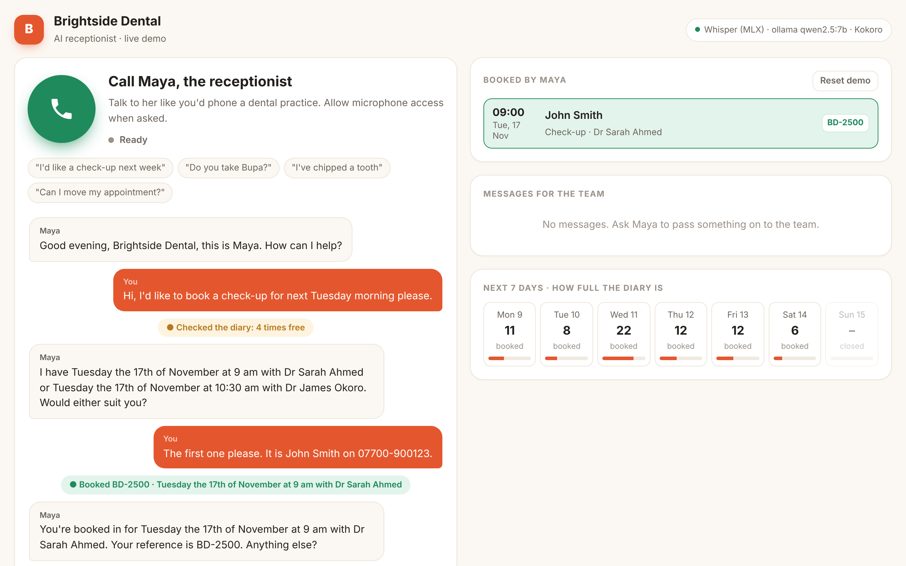

# AI Receptionist for Clinics

A voice receptionist that answers your practice's phone, books appointments straight into the diary, and never puts a caller on hold. It runs entirely on your own hardware: no per-minute AI fees, and patient conversations never leave your premises.

<!-- Demo video: drag the .mp4 into this file in GitHub's web editor to embed it here. -->

## What callers can do

- **Book an appointment.** She asks what they need, checks the real diary (opening hours, lunch breaks, which dentist works which day, how long each treatment takes), offers two times and confirms with a booking reference.
- **Move or cancel.** After checking the phone number on the booking, and applying your cancellation policy.
- **Ask questions.** Prices, insurance, parking, accessibility, new patients, all answered only from your practice's own information.
- **Get urgent help.** Pain or a broken tooth gets a same-day emergency slot held free each day. Red-flag symptoms get told to call 999 or go to A&E.
- **Reach a person.** Billing or clinical questions are transferred live to the front desk, or taken as a message for a call back when nobody is free.

Callers talk naturally and can interrupt her mid-sentence. She speaks in short sentences, reads phone numbers back to confirm them, and hangs up politely when they're done.

## Example call

> **Maya:** Good morning, Brightside Dental, this is Maya. How can I help?
> **Caller:** Hi, I'd like to book a check-up for next Tuesday morning please.
> *✓ checked the diary*
> **Maya:** I have Tuesday the 17th at 9 am with Dr Sarah Ahmed, or 10:30 am with Dr James Okoro. Would either suit you?
> **Caller:** The first one please, it's John Smith on 07700 900123.
> *✓ booked BD-2500*
> **Maya:** You're booked in for Tuesday the 17th at 9 am with Dr Sarah Ahmed. Your reference is BD-2500. Anything else?

The front desk sees every call live: the transcript, each action taken in the diary, new bookings and messages to call back.

## Why self-hosted

| | Typical hosted AI receptionist | This one |
|---|---|---|
| Where patient audio goes | the vendor's and AI providers' servers | stays on your machine |
| Running cost | monthly fee or per-minute charges | your own hardware, no AI usage fees |
| Your data and prompts | inside someone else's platform | yours |
| Changing the voice or AI model | whatever the vendor offers | any part can be swapped, local or hosted |

Built from proven open components: Whisper for speech recognition, an open LLM (Qwen 2.5) for the conversation, and Kokoro for a natural British voice, with turn detection so it knows when the caller has actually finished speaking. Each part can be swapped for a hosted service (OpenAI, Deepgram, ElevenLabs and others) if a practice prefers.

## For your practice

- Set up for your hours, team, services, prices and policies
- On your existing number through Twilio, or a new one
- Can be connected to your practice management system for live availability
- Can run on a single Apple silicon Mac or a small GPU server on site, or in your private cloud
- Adaptable to physio, vets, salons and other appointment-based businesses

**Want to hear it on a call, or run a pilot?** Email [hamzaasyf1@gmail.com](mailto:hamzaasyf1@gmail.com) or message me on [LinkedIn](https://www.linkedin.com/in/hamzaasyf/).

---

Built by Muhammad Hamza Asif, AI/ML engineer. The source code is proprietary and not published here. Brightside Dental is a fictional practice used for the demo. © 2026 all rights reserved.
